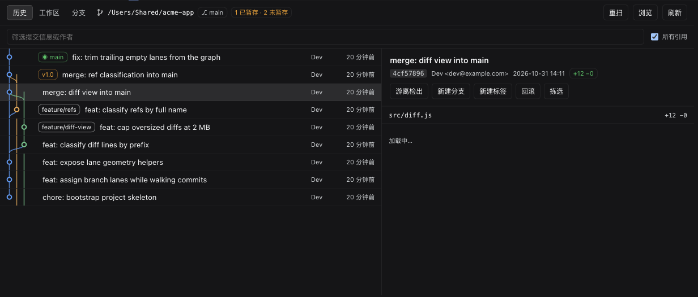
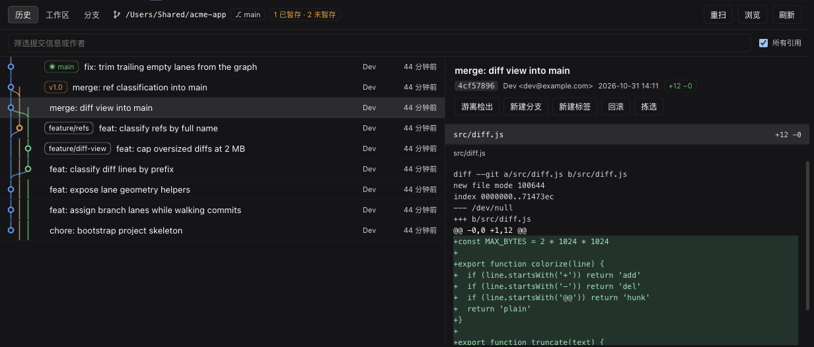
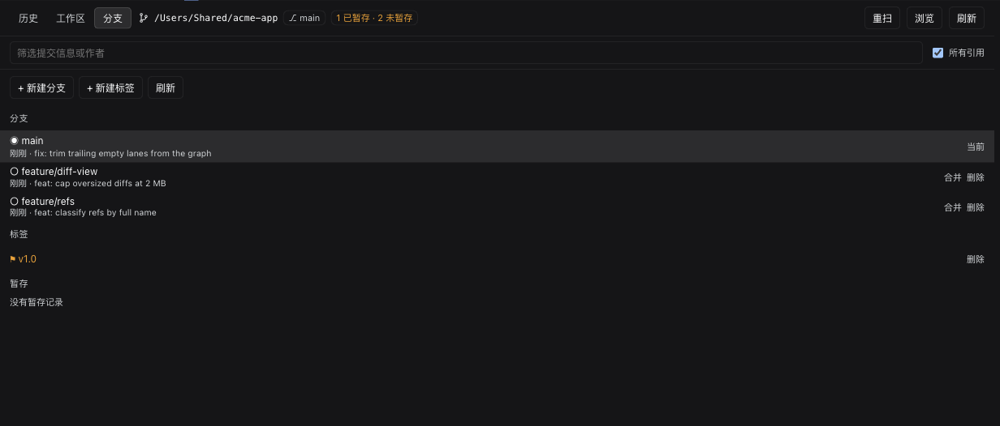

# dsh-session-git

A Git tab inside every DSH conversation.

[中文快速开始](#中文快速开始) · [Install](#install) · [Configuration](#configuration)

Each conversation gets its own **Git** tab next to `Chat | Trajectory`, and that tab
opens the repository belonging to *that* session — its working directory, not some
global one. Two sessions on two different projects can show different histories, and
neither remembers what the other picked. If the session directory cannot be resolved,
the plugin can fall back to a configured or host working directory; always check the
repository path shown in the panel before making changes.

## 中文快速开始

在 DSH 会话中打开 **Git** 页签，查看当前会话仓库的提交图、文件差异、工作区和分支。
支持暂存、提交、切换分支、合并及管理标签；推送、拉取和抓取仍在终端执行。

需要 Node.js 22 或更高版本和 DSH `0.2.1-rc.2` 或更新的兼容 0.2.x 版本；本项目已在
macOS 的 DSH `0.2.1-rc.2` 上验证。安装到 Web profile：

```sh
dsh plugin --profile web add github:koi128bit/dsh-session-git
```

安装后重启 `dsh web`，打开一个已有消息的会话，在顶部选择 **Git**。DSH Desktop 用户可在
插件管理器中添加相同的 GitHub 地址，然后重启 Desktop。卸载命令：

```sh
dsh plugin --profile web remove dsh-session-git
```

插件默认允许修改仓库，提交前默认暂存全部改动。可在[配置](#configuration)中设置
`allowWrite: false` 切换为只读。路径白名单用于限制插件选择仓库，不是操作系统沙箱；
Git 及仓库配置、hooks 仍以当前用户权限运行。

**请从 1.1.0 升级并重启 DSH。** 1.1.0 的自建 Git 接口没有使用 DSH 的登录校验；
1.1.1 改为使用 DSH Connection 的认证与请求信任检查。



## What it does

- **Bound to the session.** The tab is registered on the `conversation.view` slot, so it
  receives the current `sessionId` as a prop. Every request carries `?session=<id>`;
  the host resolves that session's working directory, then runs
  `git rev-parse --show-toplevel` on it. It can also discover repositories nested under
  the working directory; if detection fails, the documented host fallbacks apply.
- **Per-session memory.** The repository you pick is stored under
  `dsh-git-panel:repo:<sessionId>`, so one conversation switching projects does not
  change what another conversation is looking at.
- **Branch lanes.** Lanes are assigned incrementally from real parent relationships
  (newest to oldest): a parent already sitting in a column reuses that column, otherwise
  the first free column is taken, and trailing empty columns are trimmed. Linear history
  therefore stays one column wide. Merge commits draw bezier curves across columns, and
  colors come from a fixed palette indexed by column, so a refresh never reshuffles them.
- **Commit detail.** Author, time, short SHA (click to copy), `+adds −dels` totals, file
  list with per-file counts, commit body. Actions: detach checkout, create a branch or a
  tag at that commit, revert, cherry-pick.
- **Diffs.** Line-by-line coloring for added/removed lines and hunk headers, fetched per
  file on demand, with a size limit for very large diffs.
- **Working tree.** Staged/unstaged/untracked counts, per-file stage / unstage / discard,
  commit with an optional `add -A`, amend the previous commit, and stash tracked changes.
- **Refs.** Local and remote branches, tags and stashes in one page. Two-line entries
  (name plus latest commit). Switch, merge, create and delete branches; create and delete
  tags; pop stashes.



## Install

Requires Node.js 22+ and DSH `>=0.2.1-rc.2 <0.3.0-0`. Tested with DSH 0.2.1-rc.2 on
macOS. `dsh plugin` forwards its arguments to pnpm inside the profile directory:

```sh
dsh plugin --profile web add github:koi128bit/dsh-session-git
```

Or from a local checkout:

```sh
git clone https://github.com/koi128bit/dsh-session-git
dsh plugin --profile web add ./dsh-session-git
```

There is also a prebuilt tarball attached to [Releases](https://github.com/koi128bit/dsh-session-git/releases):

```sh
dsh plugin --profile web add https://github.com/koi128bit/dsh-session-git/releases/download/v1.1.1/dsh-session-git.tgz
```

Restart `dsh web` and open a conversation: a **Git** tab appears in the conversation
header. Only real conversations get it — a brand-new empty session does not render the
view area at all, so the tab shows up once the conversation has its first message.

For DSH Desktop, add the repository in its plugin manager and restart Desktop. Replace
`web` above with another profile name when appropriate. To uninstall, run
`dsh plugin --profile web remove dsh-session-git` and restart the host.

Version 1.1.0's custom Git endpoints did not require DSH authentication. Upgrade to
1.1.1 and restart the host to load the fix.

## Files

| File | Role |
| --- | --- |
| `index.js` | Host side: registers `/api/git-panel` with DSH Connection, runs `git` with argv arrays, resolves the repository from the `session` parameter |
| `client.js` | Client side: registers `conversation.view` (id `git`), plain React plus same-origin `fetch` |
| `cordis.patch.yml` | Bundle patch: one `insert` of `git-panel` |
| `locale/*.json` | Title and description shown by plugin storefronts (en / zh) |
| `screenshots.json` | Screenshots used by storefronts |
| `icon.svg`, `assets/icon-*.png` | Plugin icon |
| `assets/screenshot-*.png` | Screenshots shown above |

## API

Routes use DSH Connection's authentication and request-trust checks, returning
`{ ok, ... }`. Every route
except `/fs` and `/repos` accepts `session=<sessionId>`; the browser attaches it
automatically.

| Method | Path | Purpose |
| --- | --- | --- |
| GET | `/api/git-panel` | Capability probe: `sessionCwd`, `defaultRepo`, `autoRepos`, `autoSource`, home, allow-list, write flag |
| GET | `/api/git-panel/status` | Branch, upstream, ahead/behind, HEAD, working-tree counts, remotes |
| GET | `/api/git-panel/log` | `limit` `skip` `all` `grep` `author` `since` `path` |
| GET | `/api/git-panel/branches` | Branches and tags in one `for-each-ref` |
| GET | `/api/git-panel/commit` | One commit plus its `--numstat` file table |
| GET | `/api/git-panel/diff` | `mode=commit\|working\|staged` plus `path` |
| GET | `/api/git-panel/working` | Working-tree changes |
| GET | `/api/git-panel/fs` | Directory browser, flags repositories |
| GET | `/api/git-panel/repos` | Recursively find repositories |
| GET | `/api/git-panel/stashes` | Stash list |
| POST | `/api/git-panel/action` | `checkout` `checkout-detach` `create-branch` `delete-branch` `create-tag` `delete-tag` `merge` `merge-abort` `revert` `cherry-pick` `stash` `stash-pop` `stage` `unstage` `discard` `commit` |

`push`, `pull` and `fetch` are deliberately not exposed: they need credentials and
network interaction, and their failures cannot be closed out inside the panel.

### How the repository is resolved

Each request selects a candidate in this order. An explicitly selected or configured
directory that is invalid returns an error instead of silently selecting another repo:

1. an explicit `?repo=` parameter (something picked in the panel)
2. the plugin's `repoRoot` config
3. automatic detection from the session working directory (below)
4. the host's `workingDirectory.defaultDirectory`
5. `process.cwd()`

### Automatic detection

`GET /api/git-panel?session=<id>` reports the session's working directory and every
repository found in it:

| Field | Meaning |
| --- | --- |
| `sessionCwd` | The session's working directory |
| `autoRepos` | Repositories found there, de-duplicated and ordered |
| `autoSource` | `session-root` (the working directory is a repository), `session-child` (found below it), `config`, or `default` |

Detection takes two steps:

1. Run `git rev-parse --show-toplevel` on the session working directory — conversations
   often start inside a subdirectory of a repository (`<repo>/src`), and this resolves
   straight to the root.
2. Otherwise walk two levels down, keeping a directory as soon as it contains `.git` and
   not descending further. `node_modules`, `target`, `dist`, `build`, `.cache` and
   `Library` are skipped; at most 40 repositories are collected.

Results are ordered by depth (closest first), then by `.git` modification time
(most recent first), then by path. In a container directory holding a dozen projects,
alphabetical order would always land on the same unrelated repository; modification time
is closer to "what was touched last" and stays stable within the same second. Scans are
cached per root and depth for 8 seconds.

The top-bar dropdown only appears when more than one repository is found. Press
**Rescan** after `git init` to see a new one immediately.

## Configuration

Add an override to `$DSH_HOME/profiles/web/cordis.patch.yml` (use the selected
profile name instead of `web` when applicable):

```yaml
- id: git-panel
  config:
    repoRoot: ''            # fixed repository; empty means follow the session
    allowedRoots: []        # allow-list of roots; empty means unrestricted
    maxCommits: 400         # default commit list page size
    allowWrite: false       # disable all write actions
```

`allowedRoots` checks canonical paths, including the resolved Git root. It restricts
this plugin's repository selection but is not a sandbox for Git or repository hooks.

## Development

```sh
npm run check
npm test
pnpm pack
```

The package ships JavaScript directly and does not need a build step for a Git install.

## Implementation notes

- **No shell.** `subprocess.spawn({ argv })` executes directly, so paths containing
  spaces or `$` are safe. When `ctx.subprocess` is unavailable it falls back to
  `node:child_process.execFile`.
- **Authenticated transport.** Routes register with DSH Connection and inherit its
  authentication and request-trust checks. If Connection is absent, no Git routes mount.
  `subprocess`, `workingDirectory`, `sessions` and `sessionController` are optional.
- **The view computes its own height.** The conversation view area is `flex: 1 0 auto`,
  so it grows to fit its content — a long commit list would push the page to a few
  thousand pixels and slide under the composer. The panel measures the viewport minus the
  composer seat with a `ResizeObserver` and scrolls internally.
- **Merge diffs.** Git prints no patch for a merge commit by default, which renders as
  "no changes". Both the file list and the diff pass `-m --first-parent`, so a merge is
  shown against its first parent.
- **Ref classification.** After `--decorate=full`, local branches are `refs/heads/x` and
  remote ones `refs/remotes/o/x`. Testing for a slash misfiles `feature/x` as a remote.
- **Empty repositories.** `git log` exits non-zero when there are no commits; the host
  recognises that case and returns an empty list. Non-repositories and permission errors
  are also empty states, not red text.
- **Renames.** With `--porcelain=v1 -z`, `R` and `C` entries carry a second NUL-separated
  path; consuming only one shifts every later path.
- **Lane width cap.** With every ref shown, a repository can have dozens of live columns —
  34 columns took 449 px and squeezed the subject to 15 px. `LANE_MAX = 12` clamps the
  geometry, trading a little visual accuracy for a readable subject column.
- **Theme tokens.** The panel uses host theme tokens and a fixed palette for graph lanes.


## Known limits

- Empty conversations do not render the view area, so the tab appears after the first
  message.
- `push` / `pull` / `fetch` are out of scope (see above).
- Diff text is truncated after approximately two million UTF-16 code units. `maxCommits`
  sets the default page size; the API caps a requested page at 2,000 entries.
- A merge commit's diff is always shown relative to its first parent.



## License

MIT
